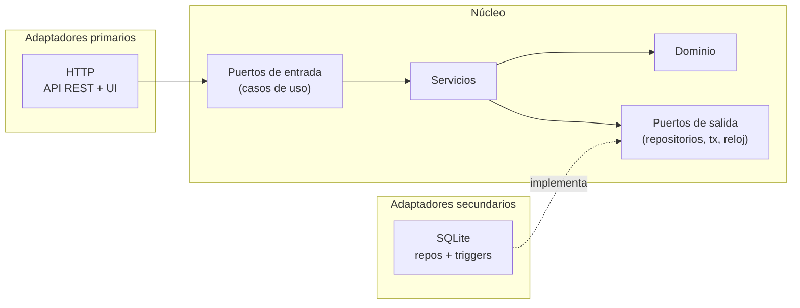
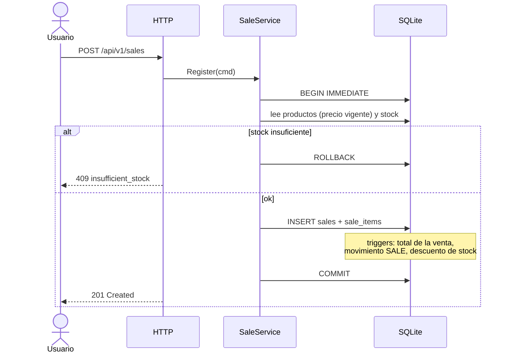
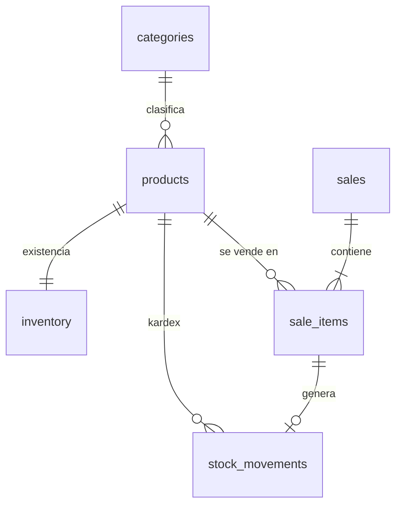

# Inventario Go

[](https://github.com/MainRDSniper09/Inventory-Project-Go/actions/workflows/ci.yml)
[](go.mod)
[](LICENSE)

Sistema de **inventario y ventas** open source escrito en Go, con **Arquitectura Hexagonal**, principios **SOLID** y **SQLite**. Se distribuye como **un único binario** (con la UI web embebida) o como **imagen Docker**.

Nació como proyecto de aprendizaje: el código está comentado en español explicando el *por qué* de cada decisión.

---

## Contenido

- [Funcionalidades](#funcionalidades)
- [Inicio rápido](#inicio-rápido)
- [Arquitectura](#arquitectura)
- [Base de datos](#base-de-datos)
- [API](#api)
- [Configuración](#configuración)
- [Pruebas](#pruebas)
- [Despliegue](#despliegue)
- [Roadmap](#roadmap)
- [Contribuir](#contribuir)

## Funcionalidades

**MVP v0.1.0**

- 📦 **Productos**: crear, listar, buscar, editar y archivar (borrado lógico). SKU único e inmutable.
- 🏷️ **Categorías** para agrupar productos.
- 📊 **Inventario con kardex**: entradas, salidas y ajustes. Cada cambio de stock queda registrado en un libro **inmutable**; el stock nunca puede ser negativo.
- 🧾 **Ventas** atómicas: el precio se toma del catálogo, el stock se descuenta automáticamente y, si algo falla, nada se guarda.
- 📈 **Dashboard**: ventas, unidades vendidas, ingresos, valor del inventario, ventas por día, productos más vendidos y alertas de stock bajo.
- 📄 **Reportes** de ventas por rango de fechas en **JSON** o **CSV** (protegido contra *CSV injection*).
- 🖥️ **UI web** embebida en el binario, con tema claro/oscuro.

## Inicio rápido

### Opción A — Docker (recomendado para servidor)

```bash
git clone https://github.com/MainRDSniper09/Inventory-Project-Go.git
cd Inventory-Project-Go
INVENTORY_SEED=true docker compose up -d --build   # con datos de demostración
```

Abre **http://localhost:8080**.

### Opción B — Binario (recomendado para usuario final)

Descarga el archivo para tu sistema desde [Releases](https://github.com/MainRDSniper09/Inventory-Project-Go/releases), descomprímelo y ejecuta:

```bash
./inventory            # Linux / macOS
inventory.exe          # Windows
```

### Opción C — Desde el código (desarrollo)

Requiere **Go 1.27+**. No necesitas gcc ni instalar SQLite.

```bash
go run ./cmd/inventory                       # BD vacía
INVENTORY_SEED=true go run ./cmd/inventory   # con datos demo
```

En PowerShell: `$env:INVENTORY_SEED="true"; go run ./cmd/inventory`

## Arquitectura

**Hexagonal (Ports & Adapters)**: el negocio está en el centro y no depende de ninguna tecnología. Las dependencias siempre apuntan hacia adentro.



```text
cmd/inventory/          Composition root (inyección de dependencias)
internal/core/domain    Entidades y reglas de negocio — sin dependencias
internal/core/ports     Interfaces (contratos) de entrada y salida
internal/core/services  Casos de uso
internal/adapters/http  API REST, middlewares, UI embebida
internal/adapters/sqlite Repositorios, migraciones, triggers y vistas
internal/platform       Configuración y reloj
```

📘 **Documentación completa** con diagrama de clases, flujo de petición, diagrama de secuencia de una venta, SOLID aplicado y estrategia de pruebas: **[docs/ARCHITECTURE.md](docs/ARCHITECTURE.md)**

### Secuencia: registrar una venta (resumen)



## Base de datos



SQLite no tiene *stored procedures*; su equivalente idiomático —que usamos— son **triggers** (mantienen stock y totales), **vistas** (consultas reutilizables) y **constraints** (`CHECK quantity >= 0`, FKs, columnas generadas).

📘 Detalle de tablas, triggers, vistas, PRAGMAs y migraciones: **[docs/DATABASE.md](docs/DATABASE.md)**

## API

| Método | Ruta | Descripción |
|---|---|---|
| `GET/POST` | `/api/v1/categories` | Listar / crear categorías |
| `GET/POST` | `/api/v1/products` | Listar-buscar / crear productos |
| `GET/PUT/DELETE` | `/api/v1/products/{id}` | Ver / editar / archivar |
| `GET/POST` | `/api/v1/products/{id}/movements` | Kardex / registrar movimiento |
| `GET/POST` | `/api/v1/sales` | Listar / registrar ventas |
| `GET` | `/api/v1/sales/{id}` | Detalle de venta |
| `GET` | `/api/v1/dashboard` | KPIs del tablero |
| `GET` | `/api/v1/reports/sales?format=csv` | Reporte de ventas |
| `GET` | `/healthz` | Health check |

```bash
curl -s -X POST localhost:8080/api/v1/products -H 'Content-Type: application/json' \
  -d '{"sku":"BEB-COLA-600","name":"Refresco cola","price_cents":1800,"initial_stock":24}'
```

📘 Referencia completa con errores y ejemplos: **[docs/API.md](docs/API.md)**

## Configuración

Variables de entorno ([12-Factor](https://12factor.net/config)):

| Variable | Default | Descripción |
|---|---|---|
| `INVENTORY_ADDR` | `:8080` | Dirección de escucha |
| `INVENTORY_DB_PATH` | `inventory.db` | Ruta del archivo SQLite (`/data/inventory.db` en Docker) |
| `INVENTORY_LOG_LEVEL` | `info` | `debug`, `info`, `warn`, `error` |
| `INVENTORY_LOG_FORMAT` | `text` | `text` o `json` (`json` en Docker) |
| `INVENTORY_SEED` | `false` | Carga datos demo si la BD está vacía |
| `INVENTORY_SHUTDOWN_TIMEOUT` | `10s` | Tiempo para apagado ordenado |

Flags: `inventory -version`, `inventory -healthcheck`.

## Pruebas

```bash
go test ./...          # todas las pruebas
go test -cover ./...   # con cobertura
make cover             # reporte HTML
```

| Nivel | Archivo | Qué valida |
|---|---|---|
| Unitarias de dominio | `core/domain/domain_test.go` | Reglas e invariantes de las entidades |
| Unitarias de casos de uso | `core/services/services_test.go` | Orquestación con *fakes* en memoria (sin BD) |
| Integración | `adapters/sqlite/sqlite_test.go` | Triggers, constraints, rollback, reportes contra SQLite real |
| Extremo a extremo | `adapters/http/http_test.go` | HTTP → servicios → SQLite, códigos de error, cabeceras |

Cobertura actual: dominio ~97 %, servicios ~91 %, HTTP ~88 %, SQLite ~76 %.

## Despliegue

| Forma | Comando | Ideal para |
|---|---|---|
| Docker Compose | `docker compose up -d --build` | Servidores, VPS |
| Imagen publicada | `docker run -p 8080:8080 -v inv:/data ghcr.io/mainrdsniper09/inventory-go` | Servidores |
| Binario | Descargar de *Releases* | PC del negocio, sin instalar nada |
| Compilar | `make build` → `bin/inventory` | Desarrollo |

La imagen es **distroless** (sin shell), corre como **usuario no-root**, con **sistema de archivos de sólo lectura** en Compose y `HEALTHCHECK` integrado.

**Publicar una versión**: `git tag v0.1.0 && git push --tags` → GitHub Actions ejecuta GoReleaser (binarios para Linux/Windows/macOS × amd64/arm64) y publica la imagen multi-arch en `ghcr.io`.

📘 Decisiones: [ADR-0004](docs/adr/0004-distribucion-binario-y-docker.md)

## Roadmap

`v0.1.0 MVP` ✅ → `v0.2.0 Seguridad y usuarios` → `v0.3.0 Compras y proveedores` → `v0.4.0 Operación (multi-almacén, códigos de barras)` → `v0.5.0 Analítica` → `v1.0.0 Producción`

📘 Detalle: **[docs/ROADMAP.md](docs/ROADMAP.md)** · Seguimiento en [Issues](https://github.com/MainRDSniper09/Inventory-Project-Go/issues) y [Milestones](https://github.com/MainRDSniper09/Inventory-Project-Go/milestones).

## Decisiones de arquitectura (ADR)

| ADR | Decisión |
|---|---|
| [0001](docs/adr/0001-arquitectura-hexagonal.md) | Arquitectura hexagonal con DI manual |
| [0002](docs/adr/0002-sqlite-go-puro.md) | SQLite con driver Go puro (sin CGO) |
| [0003](docs/adr/0003-triggers-en-lugar-de-stored-procedures.md) | Triggers y vistas como equivalente a stored procedures |
| [0004](docs/adr/0004-distribucion-binario-y-docker.md) | Distribución como binario único y Docker |

## Contribuir

Lee **[CONTRIBUTING.md](CONTRIBUTING.md)**. Issues etiquetados `good first issue` son ideales para empezar. Para vulnerabilidades, ver [SECURITY.md](SECURITY.md).

> ⚠️ El MVP **no tiene autenticación**: úsalo en local o en una red de confianza (planificado para v0.2.0).

## Licencia

[MIT](LICENSE) © 2026 Juan Barreto
