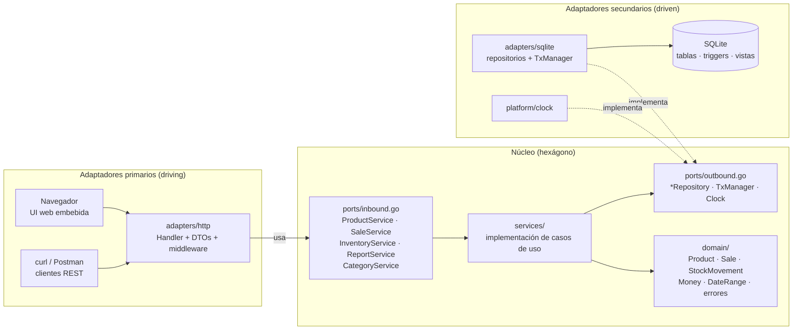
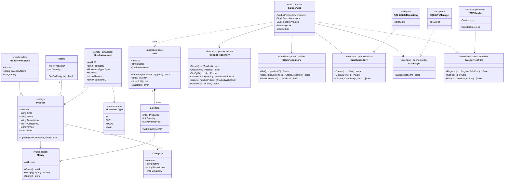
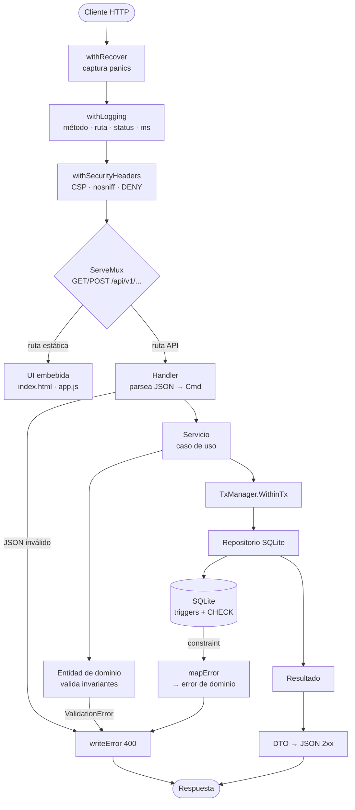
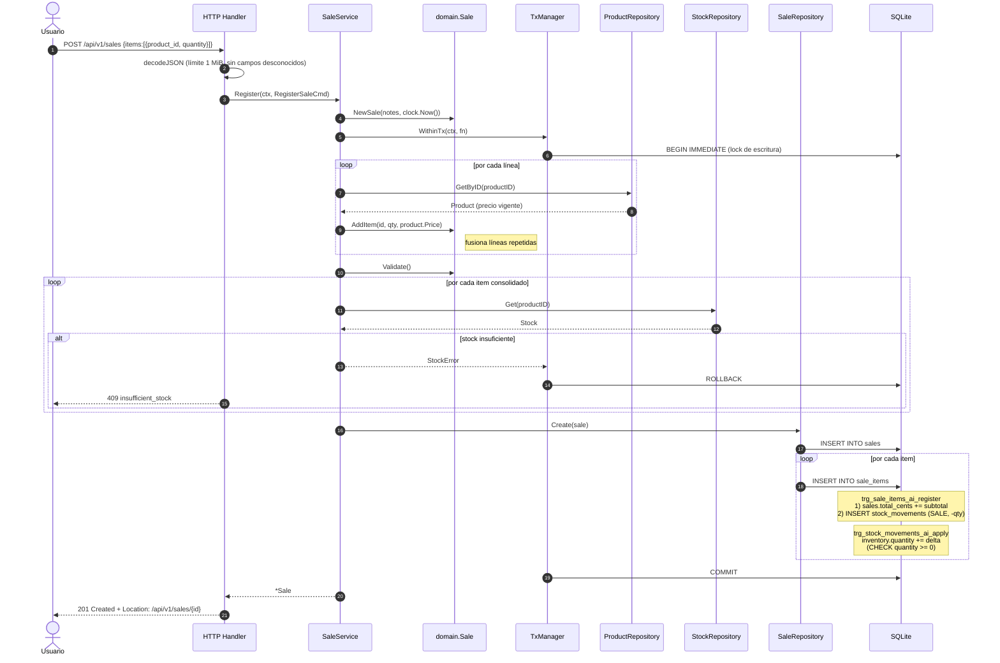
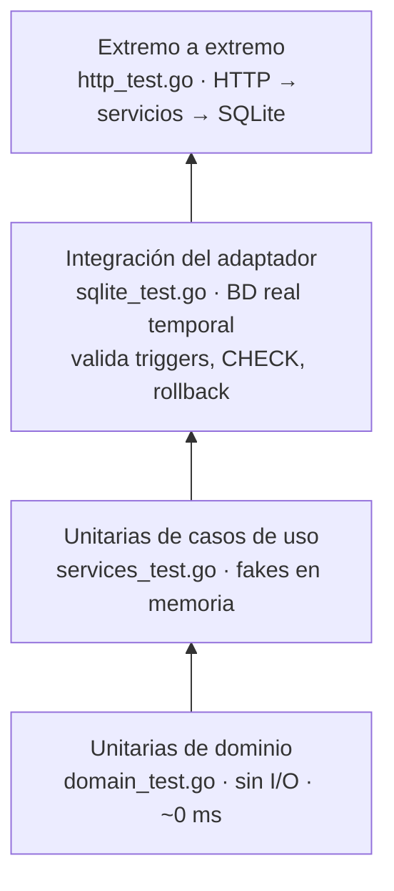
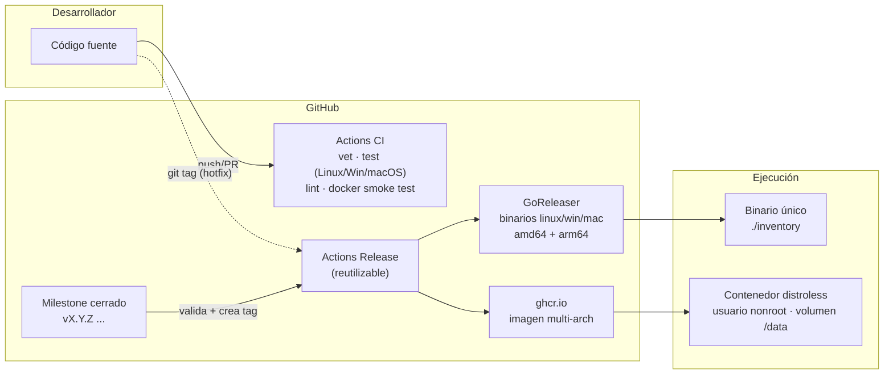

# Arquitectura

> Documento vivo. Si cambias la arquitectura, actualiza este archivo y registra la decisión en [`docs/adr/`](adr/).

## Índice

1. [Arquitectura Hexagonal en 5 minutos](#1-arquitectura-hexagonal-en-5-minutos)
2. [Mapa del código](#2-mapa-del-código)
3. [Diagrama de componentes (hexágono)](#3-diagrama-de-componentes-hexágono)
4. [Diagrama de clases](#4-diagrama-de-clases)
5. [Flujo de una petición](#5-flujo-de-una-petición)
6. [Secuencia: registrar una venta](#6-secuencia-registrar-una-venta)
7. [Principios SOLID aplicados](#7-principios-solid-aplicados)
8. [Estrategia de pruebas](#8-estrategia-de-pruebas)
9. [Despliegue](#9-despliegue)

---

## 1. Arquitectura Hexagonal en 5 minutos

La **Arquitectura Hexagonal** (o *Ports & Adapters*, Alistair Cockburn, 2005) separa el software en tres anillos:

| Anillo | Qué contiene | En este proyecto | ¿De qué depende? |
|---|---|---|---|
| **Dominio** | Entidades, value objects, reglas de negocio puras | `internal/core/domain` | De **nada** |
| **Aplicación** | Casos de uso y **puertos** (interfaces) | `internal/core/services`, `internal/core/ports` | Sólo del dominio |
| **Adaptadores** | Tecnología concreta: HTTP, SQL, CLI… | `internal/adapters/*` | Del núcleo (implementan/usan sus puertos) |

**La regla de oro: las dependencias siempre apuntan hacia adentro.** El dominio nunca importa `database/sql` ni `net/http`.

Hay dos tipos de puertos:

- **Puertos de entrada (driving / primarios)** — lo que la aplicación *ofrece*: `ProductService`, `SaleService`… Los **usa** un adaptador primario (el servidor HTTP).
- **Puertos de salida (driven / secundarios)** — lo que la aplicación *necesita*: `ProductRepository`, `TxManager`, `Clock`… Los **implementa** un adaptador secundario (SQLite).

¿Qué ganamos?

- **Testabilidad**: los servicios se prueban con *fakes* en memoria, sin BD (ver `services/fakes_test.go`).
- **Reemplazabilidad**: cambiar SQLite → PostgreSQL = escribir `internal/adapters/postgres` y cambiar 1 línea en `main.go`. El núcleo no se toca.
- **Claridad**: la lógica de negocio no está mezclada con detalles de JSON ni de SQL.

## 2. Mapa del código

```text
cmd/inventory/            ← Composition root: arma el grafo de dependencias (main.go, seed.go)
internal/
├── core/                 ← EL HEXÁGONO (sin dependencias de infraestructura)
│   ├── domain/           ← Entidades y reglas: Product, Sale, StockMovement, Money…
│   ├── ports/            ← Interfaces: inbound.go (casos de uso), outbound.go (repos, tx, reloj)
│   └── services/         ← Implementación de los casos de uso
├── adapters/
│   ├── http/             ← Adaptador PRIMARIO: API REST + UI web embebida
│   └── sqlite/           ← Adaptador SECUNDARIO: repositorios + migraciones SQL
└── platform/             ← Utilidades transversales: config (env vars), clock
```

## 3. Diagrama de componentes (hexágono)



## 4. Diagrama de clases

En Go no hay clases, pero `struct` + métodos + interfaces cumplen ese papel. Las flechas punteadas `..|>` indican "implementa".



> El diagrama muestra en detalle la rebanada **Ventas**; `ProductService`, `InventoryService`, `CategoryService` y `ReportService` siguen exactamente el mismo patrón.

## 5. Flujo de una petición



**Traducción de errores** — cada capa habla su propio idioma:

| Origen | Error | Traducido a (dominio) | HTTP |
|---|---|---|---|
| Dominio | `ValidationError{Field}` | — | `400 invalid_input` |
| SQLite | `UNIQUE constraint` | `ErrConflict` | `409 conflict` |
| SQLite | `FOREIGN KEY constraint` | `ErrInvalidInput` | `400 invalid_input` |
| SQLite | `CHECK chk_inventory_non_negative` | `ErrInsufficientStock` | `409 insufficient_stock` |
| SQLite | `sql.ErrNoRows` | `ErrNotFound` | `404 not_found` |
| Cualquier otro | — | — | `500 internal` (detalle sólo en logs) |

## 6. Secuencia: registrar una venta

El caso de uso más interesante, porque combina validación en dominio, transacción y triggers.



**Defensa en profundidad**: el stock se valida dos veces. El servicio lo verifica para dar un mensaje de error claro; la BD lo garantiza con un `CHECK` como última línea de defensa. Además, `_txlock=immediate` hace que la transacción tome el lock de escritura desde el `BEGIN`, evitando que dos ventas concurrentes lean el mismo stock.

## 7. Principios SOLID aplicados

| Principio | Dónde se ve |
|---|---|
| **S** — Responsabilidad única | `Product` no conoce su stock (eso es `Stock`/`StockMovement`). `writeError` es el único lugar que mapea errores→HTTP. `mapError` es el único que mapea SQLite→dominio. |
| **O** — Abierto/cerrado | Nuevos adaptadores (PostgreSQL, gRPC, CLI) se agregan sin modificar el núcleo. Nuevas migraciones se agregan como archivos nuevos, nunca editando las anteriores. |
| **L** — Sustitución de Liskov | Los fakes de prueba y los repositorios SQLite son intercambiables: ambos cumplen el mismo contrato y los servicios no notan la diferencia. |
| **I** — Segregación de interfaces | En vez de un `Repository` gigante hay 5 interfaces pequeñas. `InventoryService` sólo recibe `ProductRepository` y `StockRepository`; no puede tocar ventas. |
| **D** — Inversión de dependencias | Los servicios dependen de `ports.*` (abstracciones). `main.go` es el único que conoce `sqlite.*`. Las aserciones `var _ ports.X = (*Y)(nil)` verifican el contrato al compilar. |

## 8. Estrategia de pruebas



- Cada prueba de integración crea su propia BD en `t.TempDir()` → aisladas y paralelizables.
- `Clock` inyectado → fechas deterministas.
- Las pruebas de HTTP verifican que los errores internos **no** filtran detalles al cliente.

```bash
go test ./...            # todo
go test -cover ./...     # con cobertura
make cover               # reporte HTML
```

## 9. Despliegue



Dos formas de distribución, ambas generadas desde el mismo código:

1. **Binario único** (~12 MB): UI, migraciones y driver SQLite embebidos. Sin dependencias: descargar y ejecutar.
2. **Imagen Docker** distroless (sin shell), usuario no-root, `HEALTHCHECK` integrado y volumen para la BD.
