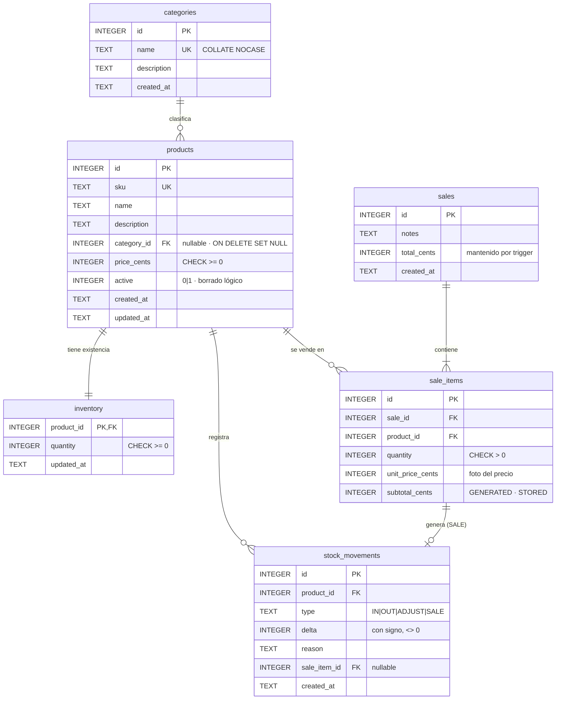
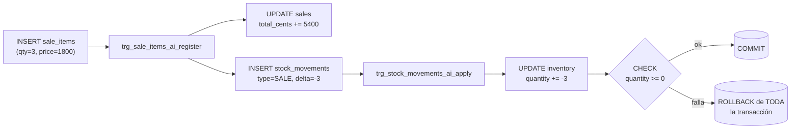

# Base de datos

Motor: **SQLite 3** vía [`modernc.org/sqlite`](https://pkg.go.dev/modernc.org/sqlite) (Go puro, sin CGO).
Esquema: [`internal/adapters/sqlite/migrations/`](../internal/adapters/sqlite/migrations/).

## Diagrama Entidad-Relación

## Decisiones de modelado

| Decisión | Por qué |
|---|---|
| **Dinero en centavos (`INTEGER`)** | `REAL` acumula errores de redondeo (0.1 + 0.2 ≠ 0.3). |
| **Fechas `TEXT` ISO-8601 UTC** (`2026-10-31T15:04:05.000Z`) | Ordenables como texto y comparables con `>=`/`<`; legibles; sin ambigüedad de zona horaria. |
| **`inventory` separada de `products`** (3FN) | El stock cambia con cada venta; el catálogo casi nunca. Separarlos evita bloqueos y escrituras innecesarias en `products`. |
| **Kardex `stock_movements` append-only** | Toda variación de stock queda auditada. `inventory` es una *proyección* derivada del libro. Para corregir se registra un `ADJUST`; nunca se edita la historia. |
| **`sale_items.unit_price_cents`** | Foto del precio al vender: si el precio cambia mañana, los reportes de hoy no se alteran. |
| **`subtotal_cents` columna generada** | La BD garantiza `subtotal = quantity * unit_price`; imposible que quede inconsistente. |
| **`UNIQUE (sale_id, product_id)`** | Una línea por producto por venta (el dominio fusiona líneas repetidas). |
| **Borrado lógico (`active = 0`)** | Un producto con ventas no puede desaparecer sin romper reportes. |

## "Stored Procedures" en SQLite

SQLite **no soporta** `CREATE PROCEDURE`. Su equivalente idiomático —y lo que usamos— es:

| Mecanismo | Objeto | Responsabilidad |
|---|---|---|
| **TRIGGER** | `trg_products_ai_create_inventory` | Al crear un producto, crea su fila de `inventory` en 0. |
| **TRIGGER** | `trg_stock_movements_ai_apply` | Cada movimiento suma su `delta` a `inventory.quantity`. |
| **TRIGGER** | `trg_sale_items_ai_register` | Por cada línea vendida: acumula `sales.total_cents` y genera un movimiento `SALE`. |
| **TRIGGER** | `trg_stock_movements_bu/bd_immutable` | Prohíbe `UPDATE`/`DELETE` en el kardex. |
| **TRIGGER** | `trg_sale_items_bu_immutable` | Prohíbe modificar líneas de venta. |
| **VIEW** | `v_product_stock` | Producto + categoría + existencia (listados, stock bajo). |
| **VIEW** | `v_sales_lines` | Detalle plano de ventas (dashboard y reportes). |
| **CHECK** | `chk_inventory_non_negative` | El stock **nunca** puede ser negativo, pase lo que pase en la aplicación. |
| **CHECK** | `chk_movement_sign` | `IN` siempre suma, `OUT`/`SALE` siempre restan. |

### Cadena de triggers al vender

> **Trade-off consciente**: lógica en triggers es poderosa pero "invisible" desde Go. Por eso la limitamos a **invariantes de datos** (mantener proyecciones y totales consistentes), mientras que las **reglas de negocio** (¿se puede vender un producto archivado?) viven en el dominio. Ver [ADR-0003](adr/0003-triggers-en-lugar-de-stored-procedures.md).

## PRAGMAs

Configurados en `sqlite.Open`:

| PRAGMA | Valor | Motivo |
|---|---|---|
| `foreign_keys` | `1` | SQLite **no** valida FKs por defecto. |
| `journal_mode` | `WAL` | Lectores concurrentes mientras se escribe. |
| `busy_timeout` | `5000` | Espera hasta 5 s en lugar de fallar con `SQLITE_BUSY`. |
| `synchronous` | `NORMAL` | Seguro con WAL y mucho más rápido que `FULL`. |
| `_txlock` | `immediate` | `BEGIN IMMEDIATE`: evita carreras leer-luego-escribir. |

## Migraciones

- Archivos `NNNN_descripcion.sql` embebidos en el binario (`//go:embed`).
- Se aplican en orden al arrancar; la tabla `schema_migrations` registra las aplicadas.
- Cada migración corre en su propia transacción: o se aplica completa o no se aplica.
- **Nunca edites una migración ya publicada**: crea una nueva (`0002_...sql`).
