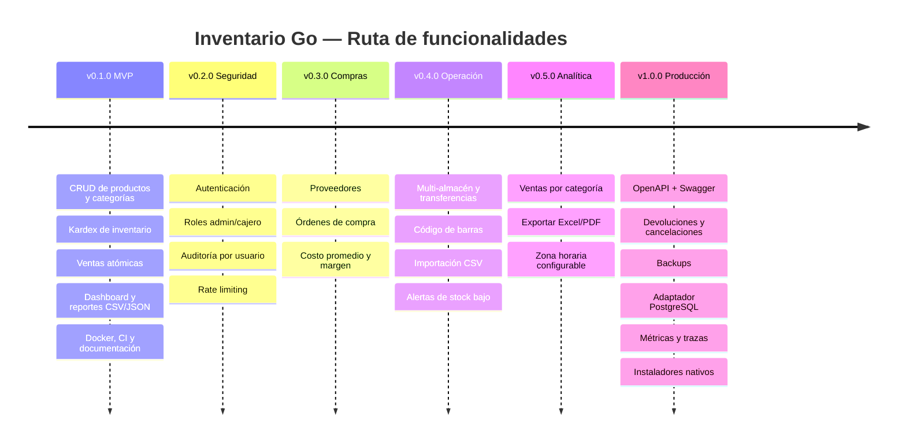

# Roadmap

Cada versión es un **Milestone** en GitHub y cada funcionalidad un **Issue** con su etiqueta. El avance se sigue en el tablero del proyecto.

## v0.1.0 — MVP ✅

- [x] Arquitectura hexagonal + SOLID
- [x] Esquema SQLite normalizado con triggers, vistas y constraints
- [x] CRUD de productos (borrado lógico) y categorías
- [x] Movimientos de inventario (entrada, salida, ajuste) con kardex inmutable
- [x] Registro de ventas atómico con descuento automático de stock
- [x] Dashboard: KPIs, ventas por día, más vendidos, stock bajo
- [x] Reporte de ventas JSON / CSV
- [x] UI web embebida
- [x] Pruebas unitarias, de integración y E2E
- [x] Docker (distroless) + Compose + GoReleaser + CI
- [x] Documentación: arquitectura, BD, API, ADRs

## v0.2.0 — Seguridad y usuarios

- [ ] Autenticación (sesiones con cookie `HttpOnly` o JWT)
- [ ] Roles y permisos (admin, cajero, sólo lectura)
- [ ] Registrar el usuario que realiza cada movimiento y venta
- [ ] Rate limiting y protección CSRF
- [ ] Configuración de TLS / guía de proxy inverso

## v0.3.0 — Compras y proveedores

- [ ] CRUD de proveedores
- [ ] Órdenes de compra → al recibirlas generan movimientos `IN`
- [ ] Costo unitario y costo promedio ponderado
- [ ] Margen de ganancia en reportes

## v0.4.0 — Operación

- [ ] Multi-almacén (stock por ubicación) y transferencias
- [ ] Código de barras / EAN por producto
- [ ] Importación/exportación masiva de productos por CSV
- [ ] Punto de reorden por producto + alertas (webhook / email)
- [ ] Paginación y ordenamiento en la UI

## v0.5.0 — Analítica

- [ ] Ventas por categoría y por periodo (semana/mes)
- [ ] Exportar reportes a Excel y PDF
- [ ] Zona horaria configurable para agrupar ventas por día local
- [ ] Gráficas adicionales en el dashboard

## v1.0.0 — Listo para producción

- [ ] Especificación OpenAPI 3 + Swagger UI
- [ ] Devoluciones y cancelación de ventas (movimientos compensatorios)
- [ ] Respaldo y restauración de la BD (`VACUUM INTO`)
- [ ] Adaptador PostgreSQL (segundo adaptador secundario)
- [ ] Métricas Prometheus y trazas OpenTelemetry
- [ ] Instaladores nativos (MSI, .deb/.rpm, Homebrew, Scoop)
- [ ] Internacionalización (es / en)
